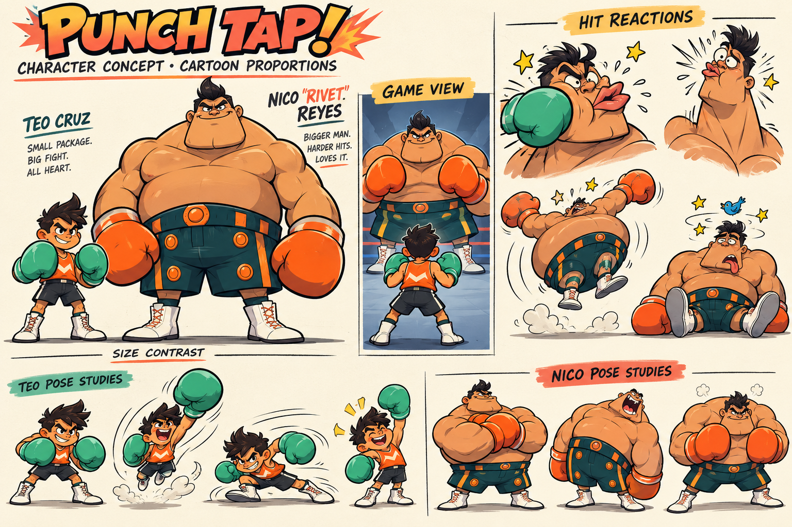

# Punch Tap!

Original portrait boxing game in Godot, using reverse engineering of a locally supplied NES ROM to recover behavior. This is ongoing development, not a completed or frame-perfect port.

Small underdog Teo Cruz faces oversized Nico “Rivet” Reyes. The approved cartoon art direction is shown above; the running build now uses cartoon pose atlases based on these references. Android and iOS are targets, not released platforms.

## Run locally

1. Clone this repository and install Godot 4.7.2.
2. Import `project.godot`, allow the asset import to finish, then press F5.
3. Press Enter to start. J/K punch, W aims high, A/D dodge, S guards, Space triggers special. Touch controls provide a joystick and separate punch/special buttons.

The game runs without a ROM. Research tools require separately supplied local inputs and are not a turnkey reproduction pipeline.

**Work in progress:** the first opponent supports tested natural KO/TKO bouts, but full-bout ROM parity, remaining visual reach differences and mobile-device validation are unfinished. See current state below.

## Start here

Read [repository rules](AGENTS.md), then [current state](docs/CURRENT_STATE.md). Load other pages only as needed.

| Page | Owns |
| --- | --- |
| [Current state](docs/CURRENT_STATE.md) | Verified handoff, blockers, next actions |
| [Architecture](docs/ARCHITECTURE.md) | Runtime boundaries and data flow |
| [Art direction](docs/ART_DIRECTION.md) | Approved characters, proportions, asset status |
| [Recovery evidence](docs/RECOVERY.md) | ROM provenance, recovery pipeline, validation limits |
| [Animation comparison](docs/ANIMATION_AUDIT.md) | Full-rate motion audit and original-art registration |
| [Development](docs/DEVELOPMENT.md) | Local setup, controls, checks |

## Contributing and repository scope

Read [contribution guidelines](CONTRIBUTING.md). Source, original art, decoded gameplay operations, numeric runtime data and research scripts are included. ROMs, extracted graphics/audio, emulator captures, local binaries and credentials are excluded. Run documentation checks and applicable game tests locally before pushing. No GitHub Actions workflows are configured; evidence-dependent tests need local fixtures.

No project-wide open-source license has been selected. Public visibility does not grant a separate project reuse license. Bundled components retain their own terms; see [third-party notices](THIRD_PARTY_NOTICES.md). This project is not affiliated with or endorsed by Nintendo.

Documentation check: `python tools/check_docs.py`.

Legacy root `.txt` files and research reports may describe superseded implementations. Use the pages above for current status; use old files only for historical evidence.
